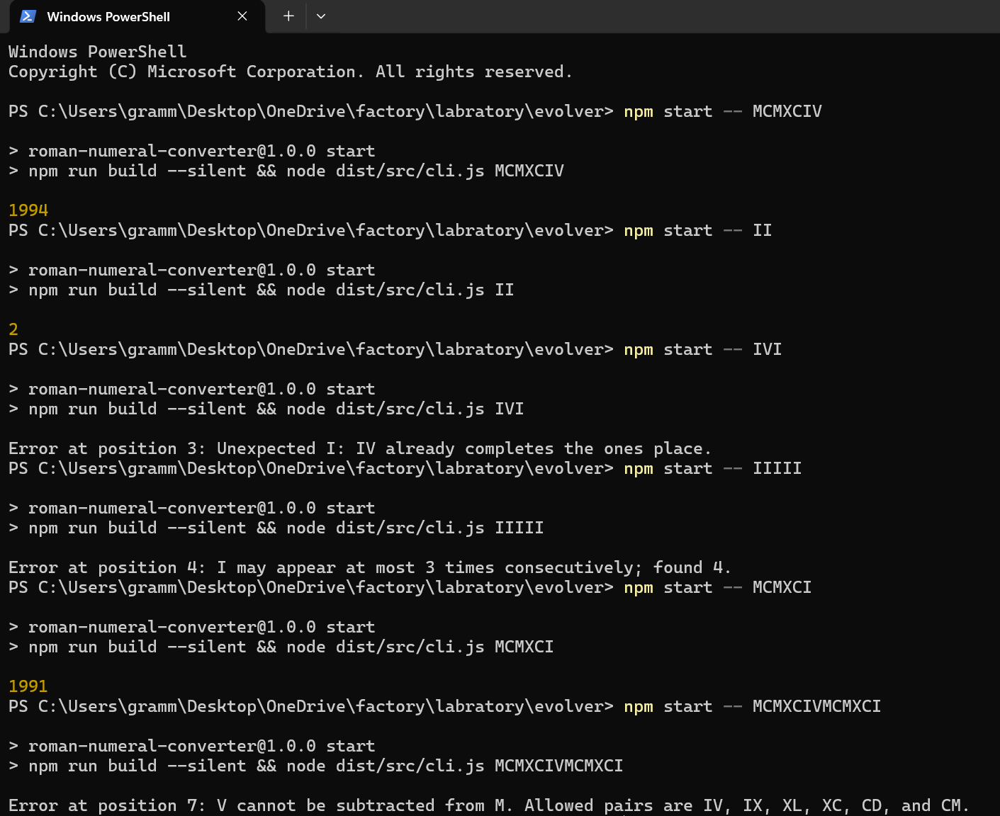

# Roman numeral converter

Here is my solution to the assignment,it turns roman numerals into numbers and it handles 1 to 3999, takes uppercase `I V X L C D M`, and it also has input validation and tells why something went wrong.

## Getting started

You just need Node.js 20 or newer. From this folder:

```sh
npm ci
npm start -- MCMXCIV
```

That prints `1994`. If you run `npm start` with no argument, you can type one numeral per line instead. To run the tests, use `npm test`. It's a small Jest set.



## How it works

Roman numerals always go in the same order: thousands, hundreds, tens, then ones. The parser walks through them in that order and looks at each place exactly once. I chose this because the rules end up sitting right next to the code, and because it means we never have to add up the letters first and then try to repair a bad numeral afterward.

At each place, it first looks for a subtraction pair like `IV` or `IX`. If there isn't one, it reads an optional five symbol followed by up to three one symbols. If any text is left over after the last place, the input is invalid. For common mistakes, like an unknown letter or too many repeats, `src/validation.ts` works out a more specific reason.

## What counts as invalid

The converter catches these mistakes:

- **Empty input, lowercase, or unknown letters.** Anything outside `I V X L C D M` is rejected, so `xiv` and `A` both fail.
- **Too many repeats.** `IIII` has too many `I`s in a row. `V`, `L`, and `D` can't repeat at all, even with other letters in between.
- **Bad subtraction.** Only `IV`, `IX`, `XL`, `XC`, `CD`, and `CM` are allowed, so `IC` is out. The subtracting letter can't repeat either, which makes `IIV` invalid too.
- **Wrong order.** Each place is read once, so `IXI` fails. By the time `IX` is done, the ones place is finished.

Every error says what went wrong and where. Positions start at 1.

## Where things live

The parser is in `src/converter.ts` and the command line is in `src/cli.ts`. The parser uses constant space and runs in time proportional to the length of the input.
